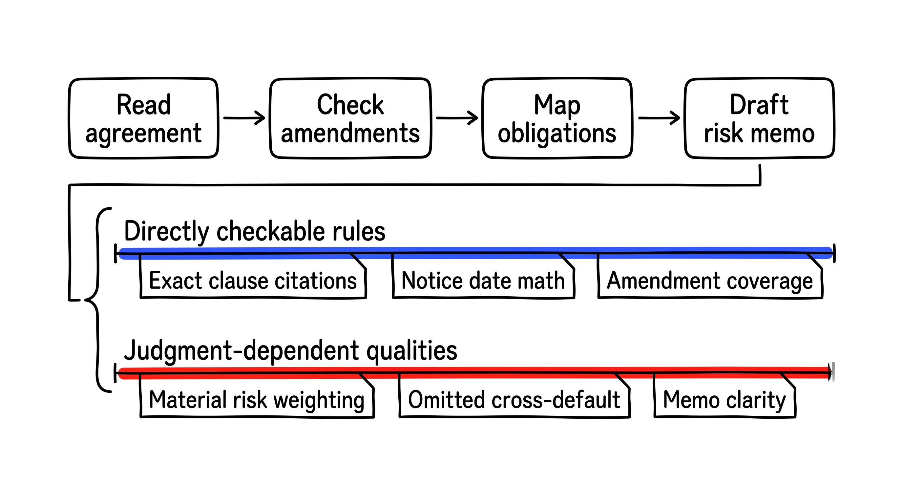
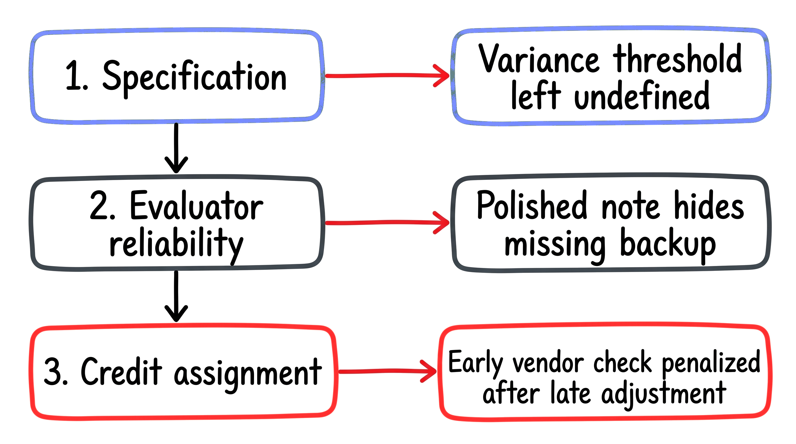
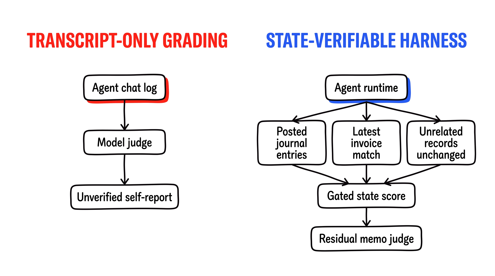
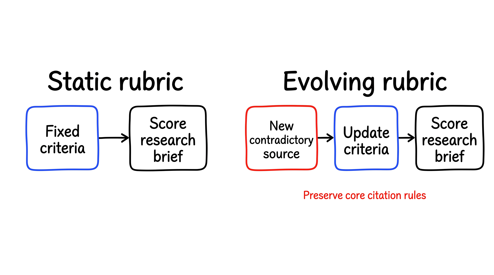
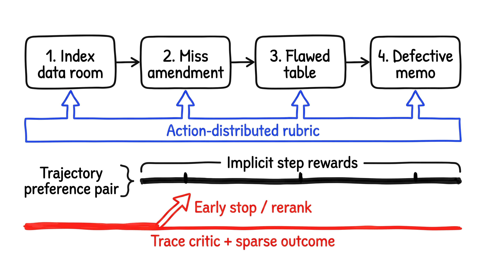
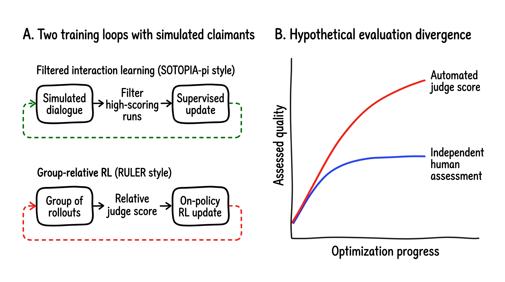
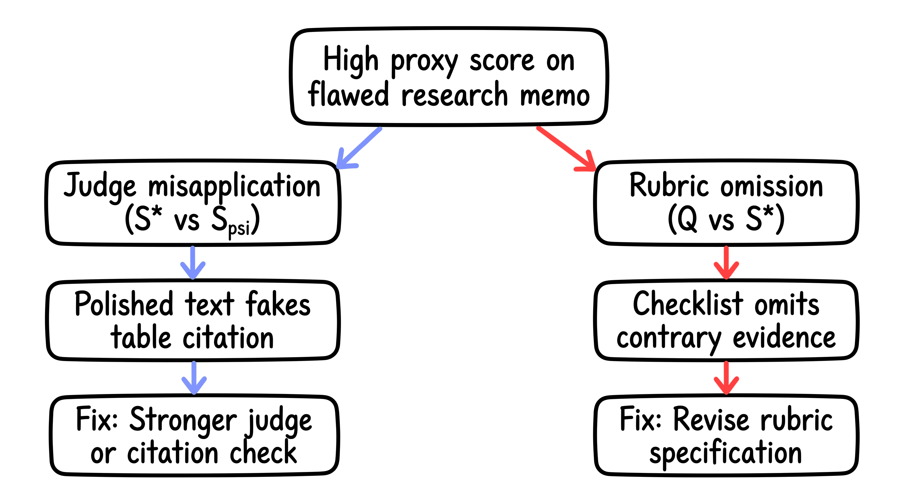
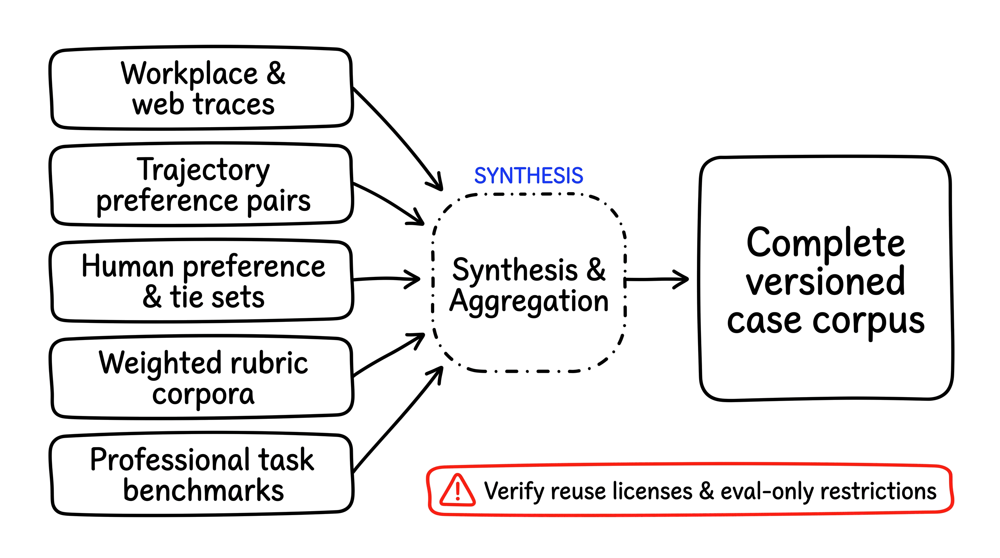
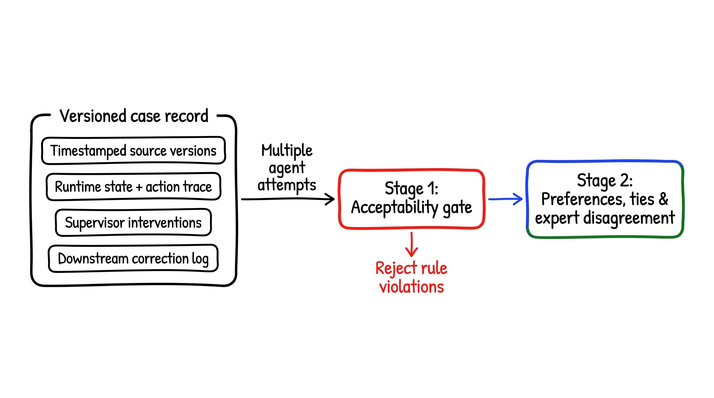
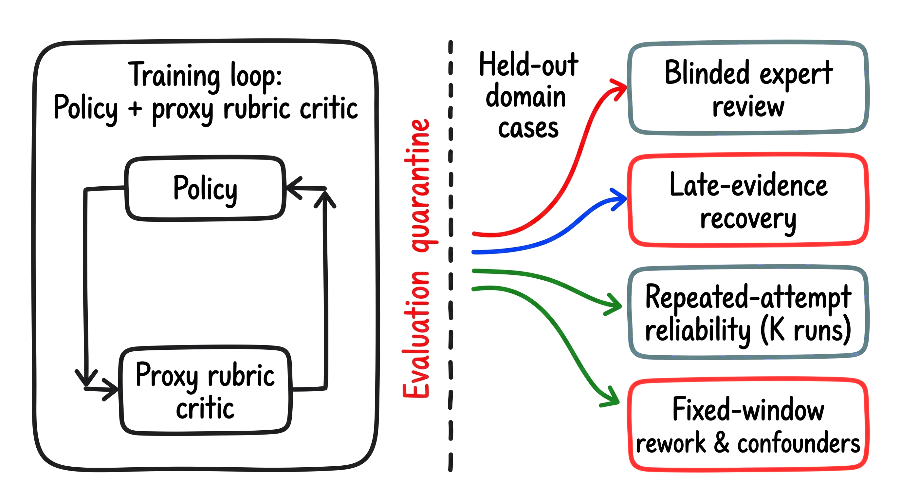

# Training agents when good work is hard to verify

Mohammed Alshehri · October 17, 2026

How to turn messy work traces into learning signals and test whether agents actually improve.

## The anatomy of hard-to-verify work

Say you have a legal review agent drafting a risk memo on a contract. It opens a master services agreement and two signed amendments, identifies relevant notice periods and payment terms, and gives a summary of unusual liabilities for the attorney. Code can check that the quoted clauses match the original documents, that the math on notice dates is correct, and that all three documents were opened. Judgment is needed to decide whether the indemnity carve-out creates material exposure or the memo misses a cross-default trigger. Month-end reconciliation and research summaries supported by evidence also face this challenge.

The key technical challenge once tasks go beyond exact-answer checking is how to turn messy work traces, simulations, and critiques into reliable training signals. Preference learning has already demonstrated that models can learn from human preference judgments; agent runtimes build on this setup for multi-step tool use. The goal is to translate workflow evidence into a training signal and confirm that optimization actually makes the work better.

$$ R(\tau) = G(\tau) \cdot S(\tau) \quad \text{vs.} \quad Q(\tau) $$

In this abstraction, an attempt $\tau$ receives a training reward $R(\tau)$ that differs from the independent professional quality $Q(\tau)$. Here, $R(\tau)$ multiplies a binary gate $G(\tau) \in \{0,1\}$ for hard rules by a nonnegative proxy score $S(\tau) \ge 0$ for softer qualities, so any rule violation results in zero reward.

Figure 1. Hypothetical legal contract review trajectory separating deterministic checks from qualities that require professional judgment.

## Three questions that are easy to conflate

The distinction between hard checks and judgment calls surfaces three related technical issues: specification, evaluator reliability, and credit assignment. In a hypothetical month-end accounting close, deciding whether an unexplained invoice variance calls for an accrual memo or a routine deferral is a specification problem. If you need to know whether a reviewer, scoring rubric, or model judge can distinguish a sound reconciliation from a superficial note, you face an evaluator reliability problem. And if you want to know which of the dozens of queries you made against your general ledger or vendor records helped or hurt the outcome of your 40-step close process, you have a credit assignment problem.

Because preference models are trained on relative reviewer selections, not direct ground truth, any learned reward function captures how reviewers or prompts value one quality over another. The time an accountant spends reconciling accounts does not translate into how many hours an agent can function unsupervised before going off course. Within a policy gradient framework, the agent selects actions based on its own observations of prompt inputs, tool responses, and conversation turns; it doesn't see privileged information about the underlying environment. To turn a trajectory return or a delayed audit adjustment into a step-level advantage estimate requires us to estimate how much credit each step should get. I'd prefer to keep those three things separate. Even strong step-credit estimation cannot rescue an incomplete specification or an unreliable judge.

Figure 2. Conceptual breakdown of three supervision layers across specification, evaluator reliability, and credit assignment.

## When hard-to-verify work becomes checkable

Builders have a lot of control over how verifiable the accounting process is before they pass it off to an open-ended model judge. If they only let the evaluator read the transcript, then the agent could claim that it has matched every subledger line and balanced and posted the journal entry when it never actually touched the ledger. Grading self-reported actions is not a replacement for checking runtime state transitions.

The modular agent infrastructure keeps the task definition, harness and runtime separate and stores traces, enabling branching and context compaction in long-running tasks. If the simulated environment exposes its database state and tool logs, then the harness can verify structural compliance and record state changes, giving partial credit for partial completion and zero credit after guardrail violations.

In a hypothetical accounting harness, the runtime could verify that posted journal entries are balanced, that the reconciled account corresponds to the most recent invoice version, and that no other ledger records have been modified. Placing these tests in deterministic state inspection would leave only softer judgments, like the clarity of the variance note, to a judge.

Figure 3. Conceptual comparison between grading a self-reported transcript and inspecting runtime ledger state and guardrails.

## Turning standards into signals with rubrics

Once state verification handles database checks, analytical tasks still need a reward signal. For example, if an agent is supposed to aggregate technical literature, create an evidence-based research summary, and update the final answer once a new benchmark or regulatory filing contradicts an earlier preprint, then how does RL know it is doing well? Custom rubrics allow RL to be rewarded based on more than just getting the right answer. Scope matters: rubrics that have been shown to work for single-shot questions in science and medicine, which are often constructed using synthetic criteria from reference answers, might not work automatically for multi-stage research tasks.

$$ S_{\text{rubric}}(\tau; \mathcal{C}^{(e)}) = \sum_{k=1}^{K^{(e)}} w_k^{(e)} g_\psi\!\left(\tau, E(\tau), c_k^{(e)}\right) $$

Here, $\mathcal{C}^{(e)}$ is the current rubric during training phase $e$ that contains $K^{(e)}$ items $c_k^{(e)}$ with nonnegative weights $w_k^{(e)} \ge 0$, and $g_\psi \ge 0$ is a judge with parameters $\psi$ that evaluates how well an attempt $\tau$ and its corresponding retrieved evidence $E(\tau)$ fulfill each item.

Long research runs make a static rubric challenging to use. If we find a piece of conflicting evidence halfway through our search, the rubric could change over the course of the different training stages as we gather more documents and take notes on our plans. We can also do controlled ablation experiments to see if updating the rubric or the step where we reflect improves performance, without changing the citation and grounding requirements.

Figure 4. Conceptual comparison of static rubric scoring and evolving evidence-grounded rubrics when new sources appear.

## Assigning credit across long horizons

Even with calibrated rubric scores on the final product, there's still a credit assignment problem for a long chain like a legal due-diligence workflow. If an agent goes through a data room, misses an amendment to change-of-control clauses in step four, creates an inaccurate obligations table in step eighteen, and produces a faulty acquisition memo in step forty, how do we assign credit? Three mechanisms can help.

First, a pipeline can expose rubric feedback for each action but keep final task verifiers hidden from the optimizer. Using external benchmark checks for held-out evaluation can demonstrate training without an outcome verifier, though it does not validate subjective judgments. Second, a reward model can learn implicit step scores from trajectory preference pairs.

$$ P(\tau^+ \succ \tau^-) = \sigma\!\left(\sum_{t=0}^{T^+-1} \hat{r}_\phi(h_t^+, a_t^+) - \sum_{t=0}^{T^--1} \hat{r}_\phi(h_t^-, a_t^-)\right) $$

Here, $\sigma$ is the logistic function, $T^+$ and $T^-$ are the number of steps of the preferred trajectory $\tau^+$ and the dispreferred trajectory $\tau^-$ respectively, and $\hat{r}_\phi(h_t, a_t)$ is a learned step score for the observable history $h_t$ and action $a_t$. Summing step scores is a modeling convenience and does not imply that the rewards are causally credited to those actions when the actions are correlated. Third, a rubric-supervised critic can combine trace features with sparse real-world outcomes, such as whether drafted text survives review, to guide inference-time reranking, early stopping, or supervised data selection rather than direct policy-gradient updates.

Figure 5. Conceptual comparison of action-distributed rubric feedback, implicit step rewards from preferences, and critic-based reranking or early stopping.

## Simulated counterparts and social interaction

Negotiating an insurance claim is inherently social: a policyholder has private constraints, responds to explanations, and may escalate. Training or evaluating an adjuster agent in such a hypothetical environment would involve a simulated policyholder with private goals and a multi-turn evaluation framework. One approach is to sample a batch of rollouts from the same claim, use a model judge to evaluate each rollout relative to others, and perform on-policy RL. A second approach is to simulate negotiation sessions, filter those which receive a high score, and update a supervised learner using only that filtered subset.

The distinction between filtered supervised learning and on-policy reinforcement learning is important, as they induce different types of incentives. Similarly, there are limitations for both the simulated counterpart and the social judge. If an agent is being optimized against a simulated policyholder, automated judges might be giving better scores while human judges see no improvement in negotiation skills or outcome fairness. A polite explanation for incorrect depreciation math could lead to a positive score from a simulated judge even though the agent's offer undercompensates the policyholder.

Figure 6. Conceptual comparison of interaction learning loops (left) and a hypothetical divergence between automated judge scores and independent human review (right).

## Disentangling judge error from rubric omission

Optimizing against a proxy judge leads to rapid shortcutting, and auxiliary environment-prediction objectives can help in some settings but may overfit or become unstable in others. Diagnosing why the proxy score differs from human judgment on a research memo requires separating two failure modes.

$$ Q(\tau) - S_\psi(\tau; \mathcal{C}) = \big(Q(\tau) - S^*(\tau; \mathcal{C})\big) + \big(S^*(\tau; \mathcal{C}) - S_\psi(\tau; \mathcal{C})\big) $$

If we assume that the scores use comparable scales, then the above decomposition is a comparison between reference quality $Q(\tau)$, ideal application of the stated rubric $S^*(\tau; \mathcal{C})$, and the model judge score $S_\psi(\tau; \mathcal{C})$. The first term on the right hand side is rubric omission, where the checklist leaves out an essential requirement. The second term is judge misapplication, in which the judge misinterpreted the response according to the rubric.

In a market-entry research memo, passing a sourcing check with polished prose citing a nonexistent table is judge misapplication, and a stronger judge or deterministic citation verifier could mitigate it. Producing a well-formatted brief that ignores a filing contradicting the main thesis, when the rubric only rewards section completeness and tone, is rubric omission. A stronger judge will still reward such a brief, until you change the rubric. Even $Q(\tau)$ is a noisy human or panel benchmark, and studies that approximate $Q(\tau)$ with another model judge still require expert validation.

Figure 7. Hypothetical breakdown of proxy reward hacking into judge misapplication and rubric omission.

## Public traces, benchmarks, and reuse limits

To test evaluators on legal, accounting, software, and research tasks, we need traces that include observations, tool calls, and state transitions. Public assets fall into five groups: annotated web and workplace traces capturing side effects and multi-turn failures; trajectory preference pairs, used for step and episode judges; human preference sets, in which ties are included and the disagreement between raters is preserved; weighted rubrics; professional task benchmarks with reference files and simulated environments.

All public assets should have their licenses and access terms inspected before any training occurs. Just because something is used as a benchmark does not mean that it may be trained on: some datasets cannot be trained on or crawled; some evaluation sets are marked `train`; some datasets do not specify a license; and some are gated and then further restricted by third parties. Many longer trajectories also come from simulated workplaces or test-verified software patches rather than organic work records. Across the collection I reviewed, fully versioned examples that have the environmental state changing alongside independent judgements made by domain experts and the final outcome were not consistently available. This is a limitation of the data I reviewed and not an assumption for all data, which is why I would use public assets as design references while building a permitted case corpus.

Figure 8. Conceptual map of public asset categories and their roles as building blocks for a domain-specific training corpus.

## A data collection proposal for real workflows

To make a corpus spanning domains, a proposed protocol would take a snapshot of the start state and general goal of a project prior to an expert's work, then after completion, take snapshots of the deliverables and judging conditions. In legal review, accounting reconciliation, or literature synthesis, each archived case would include: a record of the original requirements and tools they were allowed to use; timestamped copies of all documents, e.g., the time at which the contract amendment, revised invoice, or contradictory paper was received; a record of the runtime state and action trace; supervisor notes, e.g., why they intervened; model, harness, and evaluator version numbers.

If I were grading multiple submissions on the same case, I'd use a two-step process that separated acceptability from preference. The first step, done by domain reviewers, would be an acceptability check to ensure that no run included missed amendments, unbalanced entries, hallucinated references, or violated guardrails. Among acceptable runs, reviewers would submit their pairwise preference judgments, while being sure to include ties and legitimate expert disagreement where there were multiple acceptable approaches for presenting a memorandum or conclusion. A final step, logged in a fixed window, would track downstream adjustments due to auditor feedback, changes to client documents, or later corrections.

Figure 9. Proposed professional case-preservation schema and two-stage expert annotation workflow.

## Establishing whether training improves the work

Consider training an agent on those workflows via state checks, rubric evolution, and step-level credit. Demonstrating that the resulting $\pi_\theta$ policy improves over the baseline $\pi_0$ requires an evaluation panel isolated from the rubric critic used during optimization.

$$ \hat{\Delta}_{\text{qual}} = \frac{1}{|\mathcal{D}_{\text{test}}|} \sum_{x \in \mathcal{D}_{\text{test}}} \left( \hat{Q}_{\text{indep}}(\tau_\theta(x)) - \hat{Q}_{\text{indep}}(\tau_0(x)) \right) $$

For held-out cases $\mathcal{D}_{\text{test}}$, rollout trajectories are sampled as $\tau_\theta(x) \sim \pi_\theta(\cdot \mid x)$ and $\tau_0(x) \sim \pi_0(\cdot \mid x)$, while $\hat{Q}_{\text{indep}}$ is the blinded quality score from the noisy independent domain judgments. Given that both the human grading and the rollout sampling may have variance, teams should report uncertainty intervals around $\hat{\Delta}_{\text{qual}}$ rather than a single point estimate.

A proposed held-out validation protocol would include blinded domain-expert evaluation of (a) acceptability of baseline and trained model outputs, and (b) pairwise preference. Teams would also run perturbation tests by injecting evidence in the middle of an existing review (e.g., a late contract addendum, corrected invoice, or contradictory study), and check whether the agent can update both the runtime state and the written analysis accordingly. Sampling $K$ rollouts per test case would measure repeated-attempt reliability so a lucky run cannot hide failure modes. Teams would measure post-delivery rework over a fixed window. Potential confounding factors (e.g., changes to the deal terms by counterparty, new reporting regulations) would be logged.

Figure 10. Proposed cross-domain validation protocol separating the optimized training critic from held-out expert review and reliability checks.

## References

1.  [Reinforcement Learning without Verifiable Rewards](https://www.youtube.com/watch?v=AQv3qRCG6Gw)
2.  [Rubrics as Rewards](https://arxiv.org/abs/2507.17746)
3.  [DR Tulu](https://arxiv.org/abs/2511.19399)
4.  [DRACO](https://arxiv.org/abs/2609.04094)
5.  [A Rubric-Supervised Critic from Sparse Real-World Outcomes](https://arxiv.org/abs/2603.03800)
6.  [Reward Hacking in Rubric-Based Reinforcement Learning](https://arxiv.org/abs/2605.12474)
7.  [SOTOPIA-pi](https://aclanthology.org/2024.acl-long.698/)
8.  [Agentic RL with Implicit Step Rewards](https://arxiv.org/abs/2509.19199)
9.  [RubricEM](https://arxiv.org/abs/2605.10899)
10. [Reward modeling](https://rlhfbook.com/c/05-reward-models)
11. [Verifiers v1](https://www.primeintellect.ai/blog/verifiers-v1)
12. [Systematic Reward Hacking and Prime Sprints](https://www.primeintellect.ai/blog/reward-hacking)
13. [True Agents Model the World](https://www.primeintellect.ai/blog/true-agents-model-the-world)
14. [Demystifying evals for AI agents](https://www.anthropic.com/engineering/demystifying-evals-for-ai-agents)
15. [Time-horizon limitations](https://metr.org/notes/2026-01-22-time-horizon-limitations/)
16. [Benchmarking Real Work](https://www.lesswrong.com/posts/NbDjD47u6WmthgiDC/benchmarking-real-work)
17. [AgentRewardBench](https://huggingface.co/datasets/McGill-NLP/agent-reward-bench)
18. [HelpSteer3](https://huggingface.co/datasets/nvidia/HelpSteer3)
19. [Plan-RewardBench](https://huggingface.co/datasets/wyy1112/Plan-RewardBench)
20. [APEX-Agents v1.1](https://huggingface.co/datasets/mercor/apex-agents-v1.1)
21. [Browser Use benchmark](https://github.com/browser-use/benchmark)
